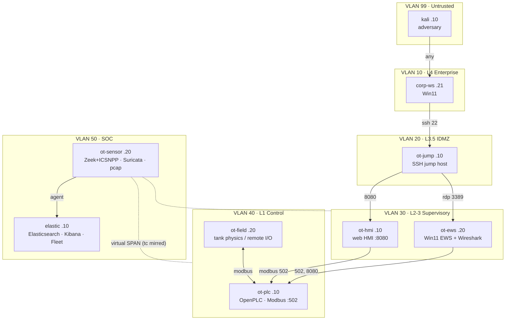

# OT/ICS Defense Lab — Ludus + Proxmox

A reproducible, Purdue-model industrial control system lab for learning to **detect and respond to attacks on OT networks** with **Elastic Security, Zeek, Suricata and Wireshark**. One `ludus range deploy` builds a small water-treatment process: a real soft-PLC, an HMI, simulated field I/O with physics, an IDMZ, a passive network sensor, Elastic, and an attacker.

Each scenario follows the same loop: **attack → observe → detect → respond → harden → write it up.**



## What's in the box

| Component | What it is | Why it's here |
|---|---|---|
| **ot-plc** | [OpenPLC v3](https://github.com/thiagoralves/OpenPLC_v3) running `water_tank.st` | Real IEC 61131-3 runtime with a real Modbus/TCP stack and a web programming interface |
| **ot-field** | Python tank physics acting as remote I/O | Gives attacks a *physical* consequence (overflow) and a ground-truth log |
| **ot-hmi** | Lightweight web HMI | Generates deterministic polling baseline + an operator **audit log** |
| **ot-ews** | Windows 11 engineering workstation | Programming path, Elastic Defend + Sysmon, Wireshark |
| **ot-jump** | IDMZ jump host | The only conduit from IT to OT (with a weak credential to abuse) |
| **ot-sensor** | Zeek + CISA ICSNPP, Suricata 7 (Modbus/DNP3/ENIP parsers), rolling pcap | Passive OT network monitoring, the way real plants do it |
| **elastic** | Elastic Container Project via Ludus role | SIEM, detections, timeline, cases |
| **kali** | Attacker | Runs `attacks/ot_attack.py`, nmap, ettercap |

## Quick start

```bash
git clone https://github.com/<you>/ot-ics-lab && cd ot-ics-lab
./scripts/ludus-host/upload-roles.sh                 # add roles to Ludus
ludus range config set -f ludus/range-config.full.yml   # or range-config.lite.yml
ludus range deploy && ludus range logs -f
sudo RANGE_ID=<id> ./scripts/ludus-host/ot-span.sh setup  # on the Proxmox host
ludus range deploy -t user-defined-roles --limit <id>-ot-sensor
```
Full walkthrough: **[docs/02-deploy.md](docs/02-deploy.md)**.

## Learning path

| # | Scenario | ATT&CK for ICS | Primary detection |
|---|---|---|---|
| 0 | [Baseline the plant](scenarios/00-baseline.md) | — | Know normal before hunting abnormal |
| 1 | [OT discovery from a foothold](scenarios/01-recon.md) | T0846, T0888 | Zeek notice, Suricata 9000010-13, new-terms rule |
| 2 | [Unauthorized command → overflow](scenarios/02-unauthorized-command.md) | T0855, T0831, T0879 | ES\|QL write allow-list, process overflow |
| 3 | [Setpoint tampering](scenarios/03-setpoint-tampering.md) | T0836 | Suricata 9000002, HMI-audit correlation |
| 4 | [Rogue program download](scenarios/04-program-download.md) | T0812, T0843, T0881 | Suricata 9000030-33, Zeek HTTP |
| 5 | [Spoofed telemetry / AitM](scenarios/05-spoofed-telemetry.md) | T0856, T0830 | Write-without-audit ES\|QL, ARP in Wireshark |
| 6 | [Denial of control](scenarios/06-denial-of-control.md) | T0814, T0829 | Threshold rule, Suricata 9000020-22 |
| 7 | [IT → OT pivot through the IDMZ](scenarios/07-it-to-ot-pivot.md) | T0859, T0886 | Conduit violation, auth logs, Defend |

## Repo layout

```
ludus/            range configs (full / lite) with Purdue firewall rules
ansible/roles/    ot_openplc, ot_field_sim, ot_hmi, ot_jumphost, ot_sensor
scripts/          ludus-host (SPAN, role upload), elastic (Fleet, rule import), sensor
detections/       Elastic rules (JSON), pointers to Suricata/Zeek content
attacks/          ot_attack.py - small, readable Modbus adversary tool
scenarios/        step-by-step exercises with expected telemetry
docs/             architecture, deploy, sensor, Elastic, Wireshark, detection engineering
journal/          lab write-ups (one per session) - your portfolio
AGENTS.md         operating rules for AI agents working on this lab
```

## Safety

Everything here targets **only** the lab range (`10.<range>.0.0/16`). The attack tool refuses targets outside 10/8 by default. The weak credentials (OpenPLC `openplc/openplc`, jump host `otjump`) are intentional training weaknesses — never reuse this config outside an isolated lab.

## License

MIT
